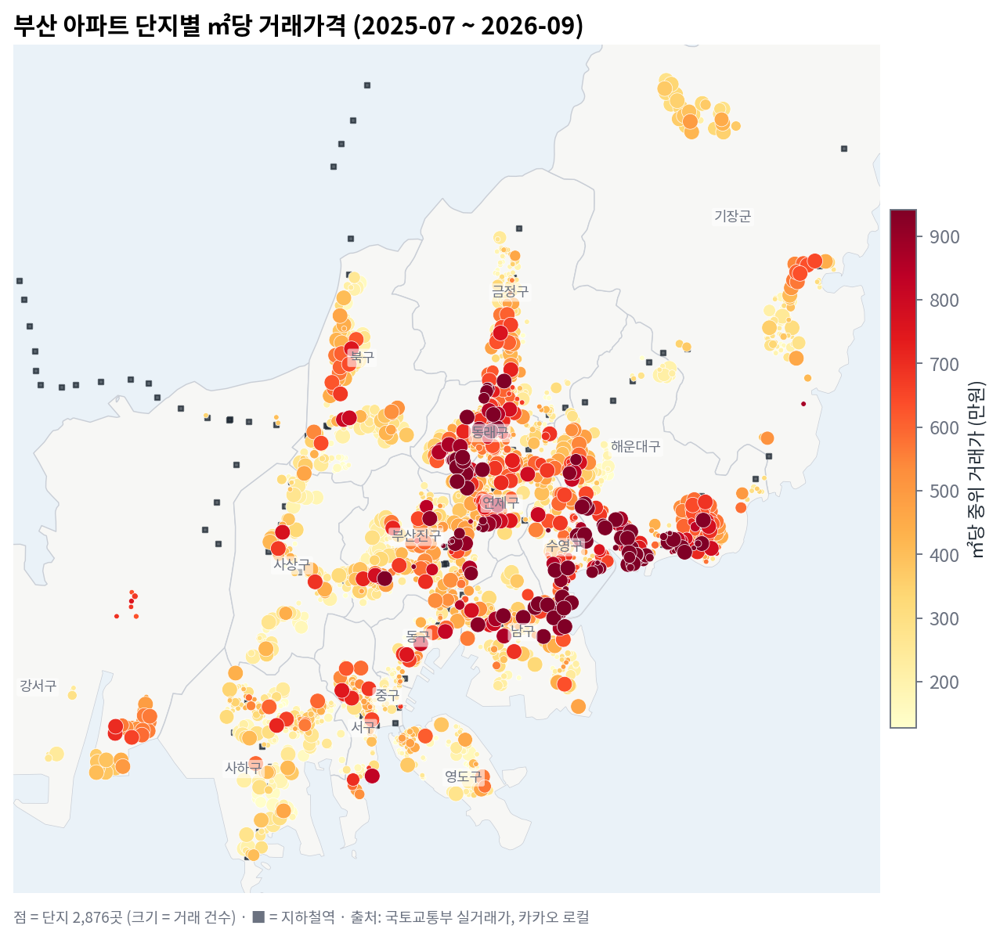
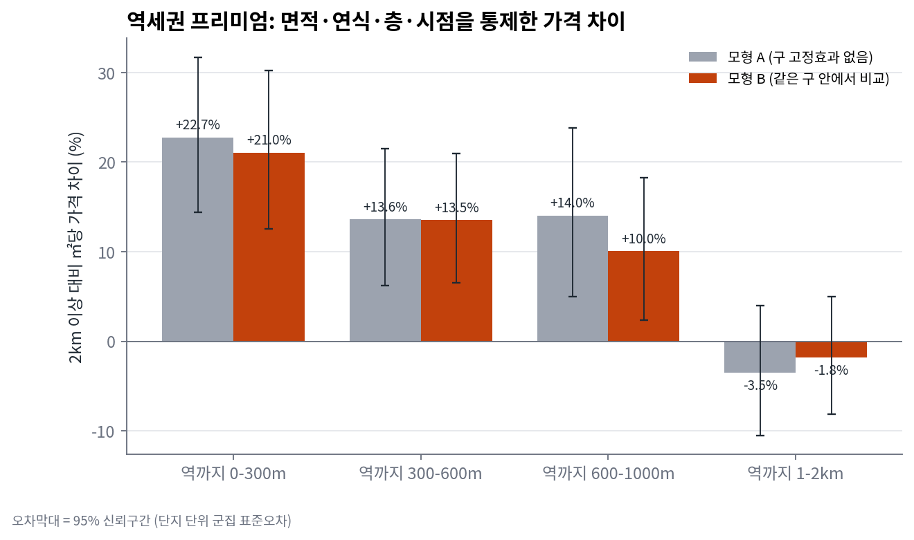
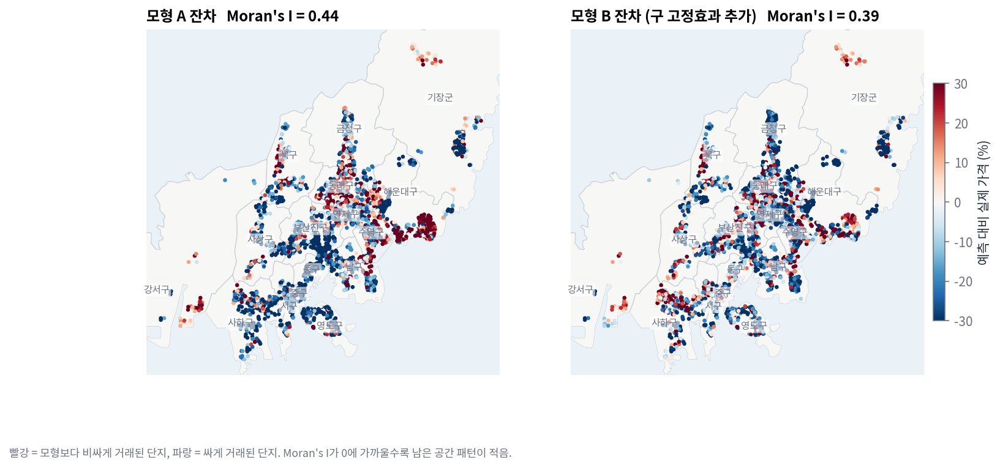
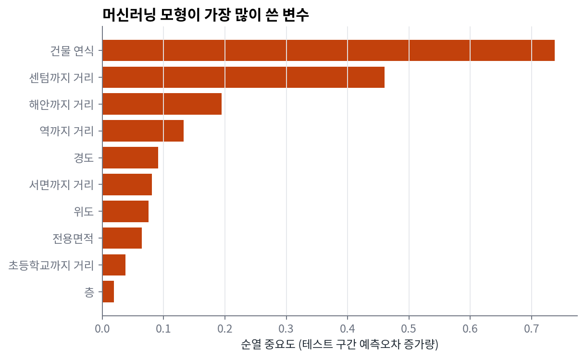
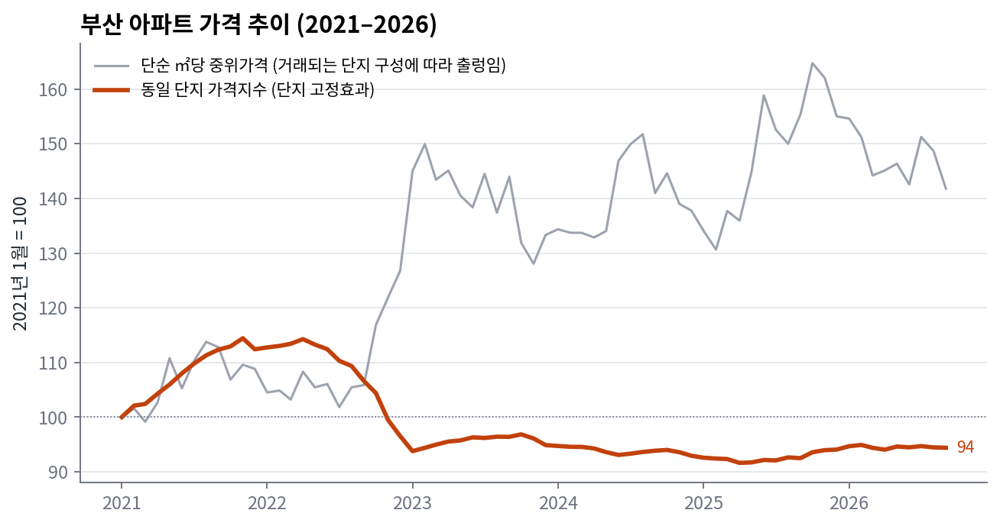

# 부산 아파트 가격의 입지 요인 분석 — 역세권은 얼마의 가치가 있나?

**What drives apartment prices in Busan?** 국토교통부 실거래가 17만 건과 카카오 로컬 API를 결합해 부산 아파트 가격에서 입지(지하철역·해안·도심·학교)의 효과를 측정한 공간 데이터 분석 프로젝트



## 핵심 결과

| 질문 | 답 (모형 B: 면적·연식·층·시점·구 통제) |
|---|---|
| 역세권 프리미엄은? | 역까지 **300m 이내 +21.0%** (95% CI 12.5–30.2%), 300–600m +13.5%, 600m–1km +10.0%, **1km를 넘으면 차이 없음** (2km 이상 대비 ㎡당 가격) |
| 바다가 가까우면? | 해안까지 거리가 2배가 될 때마다 **−8%** |
| 도심(서면·센텀)에서 멀어지면? | 거리 2배마다 **−5%** |
| 초등학교 300m 이내? | **+8.5%** |
| 오래된 아파트는 싸다? | 연식 1년당 약 −5%로 하락하다가 **약 33년차부터 다시 상승** — 재건축 기대가 가격에 반영 |
| 부산 집값은 실제로 어떻게 움직였나? | 같은 단지 기준 **2021년 11월 정점(+14%) → 2023년 1월까지 −18%**, 이후 보합. 2026년 9월은 2021년 1월 대비 −5.6% |



## 데이터

| 데이터 | 출처 | 규모 |
|---|---|---|
| 아파트 매매 실거래가 (상세) | 국토교통부 공공데이터 API, 부산 16개 구·군 × 69개월 | 176,788건 (2021-01 ~ 2026-09) |
| 단지 좌표 | 카카오 로컬 API (지번 → 도로명 주소 순 지오코딩) | 4,388개 단지 중 4,387개 (99.98%) |
| 지하철역 | 카카오 로컬 카테고리 검색 (부산 1–4호선, 동해선, 부산김해경전철) | 149개 역 |
| 초·중·고등학교 | 카카오 로컬 카테고리 검색 | 871개 (초등학교 414개) |
| 행정구역·해안 | 행정동 경계 (vuski/admdongkor) → 해역 폴리곤 생성 | 16개 구·군 |

카카오 카테고리 검색은 1회 최대 45건까지만 반환하므로, 결과가 45건을 넘는 영역은 4등분해 다시 검색하는 **재귀 영역 분할**로 전체를 수집했다.

## 데이터 정제 — 무엇을 왜 제외했나

| 단계 | 건수 |
|---|---:|
| 원본 거래 | 176,788 |
| 완전 동일 레코드 제거 | 175,592 |
| **계약 해제 거래 제외** (`cdealType`) | 164,906 |
| 면적 15–250㎡, 지상층, 건축연도 정상 | 164,861 |
| 단지·연도 중위값 대비 ±50% 이상 이탈 (이상치) | 379건 표시 |
| **직거래·이상치 제외**, 좌표 확보 → 모형 분석 대상 | **151,757건, 4,261개 단지** |

- **직거래를 뺀 이유:** 같은 단지·연도 중위값보다 20% 이상 싸게 거래된 비율이 직거래 10.2%, 중개거래 2.3%. 직거래에는 가족 간 거래처럼 시장가가 아닌 거래가 더 많이 섞여 있다.
- **지오코딩 검증:** 좌표가 거래 신고된 구·군 경계 밖에 떨어진 6개 단지는 주소 매칭 오류로 보고 제외했다.

상세: [`output/cleaning_log.md`](output/cleaning_log.md), [`output/geocoding_qa.md`](output/geocoding_qa.md)

## 분석 방법

**1. 헤도닉 가격모형 (OLS)** — `log(㎡당 가격)`을 면적, 연식(2차항), 층, 역까지 거리 구간, 해안·도심 거리(로그), 초등학교 300m 여부, 거래월 고정효과로 설명. 같은 단지의 거래들은 서로 독립이 아니므로 **단지 단위 군집 표준오차**를 사용했다.
- 모형 A: 구 고정효과 없음 (R² 0.51)
- 모형 B: + 구 고정효과 → 같은 구 안에서의 입지 효과 (R² 0.62)

**2. 공간 자기상관 검정** — 단지별 평균 잔차에 Moran's I (8-최근접 이웃, 순열검정 499회). 모형 B에서도 **I = 0.39 (p < 0.01)** → 구 단위로는 설명되지 않는 동네 단위 효과가 남아 있다.

잔차를 더 들여다보면, 기간 중 거래 건수가 적은 단지(소규모 단지의 대리변수) 하위 25%는 평균 **약 25% 예측보다 싸게**, 상위 25%는 예측과 거의 같게 거래됐다 (거래 건수–잔차 순위상관 0.38). 데이터에 없는 **단지 규모(세대수)·브랜드** 효과가 가장 큰 누락 변수로 보이며, 공동주택 단지 정보와 결합하는 것이 다음 단계다.



**3. 머신러닝 비교 (시간 기준 홀드아웃)** — 2025년 6월까지로 학습하고 이후 15개월(39,721건)을 예측.

| 모형 | 테스트 R² | 예측오차 중위값 |
|---|---:|---:|
| OLS (모형 B 변수 + 선형 추세) | 0.64 | 21.7% |
| Gradient Boosting (같은 변수 + 위·경도) | **0.94** | **8.1%** |

두 모형의 차이는 Moran's I 결과와 같은 이야기를 한다. 가격에는 구·역·해안 거리로 요약되지 않는 **세밀한 위치 정보**가 크게 작용하고, 좌표를 직접 쓸 수 있는 트리 모형이 그것을 잡아낸다. 해석은 OLS, 예측은 GBM — 목적에 따라 모형을 고른다.



**4. 가격지수 — 단순 중위가격의 함정**



단순 ㎡당 중위가격은 2021년 대비 +40%를 넘지만, 이는 하락기에 신축·고가 단지 거래 비중이 늘어난 **구성 효과**다. 단지 고정효과로 같은 단지끼리 비교하면 실제로는 2021년 말 정점 이후 18% 하락했다. (모형 B의 월 효과로 만든 헤도닉 지수는 '같은 연식' 기준이라 노후화 효과가 빠져 있어 +17%로 나온다 — 지수를 무엇으로 정의하느냐에 따라 결론이 달라진다는 점도 확인했다.)

## 한계

- 단지 고정효과 모형이 아니므로 역세권 효과에는 단지 브랜드·규모 등 관측되지 않은 특성이 일부 섞여 있을 수 있다 (인과효과가 아닌 조건부 상관).
- 역까지 거리는 직선거리이며, 도보 경로·출구 위치는 반영하지 않았다.
- 학교는 위치만 사용했고 학군 품질(학업성취도 등)은 반영하지 않았다.
- 2026년 하반기 거래는 신고 기한(계약 후 30일) 때문에 일부 누락될 수 있다.

## 실행 방법

```bash
pip install pandas geopandas pyogrio statsmodels scikit-learn scipy matplotlib pyarrow requests
./run_all.sh                       # data/raw 의 수집 데이터로 정제 → 변수 → 모형 → 그림
```

데이터를 새로 수집하려면 `keys.txt`에 `DATA_GO_KR=`(공공데이터포털 인증키)와 `KAKAO_REST=`(카카오 REST API 키)를 넣고 `scripts/00_collect.py`의 `trades → (01_clean) → geocode → poi` 순으로 실행한다. 공공데이터 API는 초당 호출 제한이 있어 요청 간격을 두고 재시도하도록 작성했다.

```
scripts/00_collect.py   데이터 수집 (실거래가 API, 카카오 지오코딩·POI)
scripts/01_clean.py     정제 + 정제 로그
scripts/02_features.py  지오코딩 검증 + 입지 변수 (UTM-K, KD-tree 최근접 거리)
scripts/03_model.py     헤도닉 OLS, Moran's I, 동일 단지 가격지수, GBM 홀드아웃
scripts/04_figures.py   지도·차트
```

**사용 기술:** Python · pandas · GeoPandas · statsmodels · scikit-learn · SciPy (KD-tree, 희소행렬 최소제곱) · Matplotlib · REST API (공공데이터포털, 카카오 로컬)

---

**English summary.** 176,788 Busan apartment sales (2021–2026) from the Ministry of Land API were cleaned (cancelled deals, non-market direct deals, outliers), geocoded with the Kakao Local API (99.98% match), and joined with subway stations, schools and coastline. A hedonic model with clustered standard errors finds a **+21% price premium within 300 m of a station** that disappears beyond 1 km; Moran's I on residuals shows remaining neighborhood effects, which a gradient-boosting model with coordinates captures (holdout R² 0.94 vs 0.64). A same-complex price index shows prices fell 18% from the late-2021 peak, while the naive median suggests a rise — a composition effect. Author: Axror Abduhamitov, 2026.
